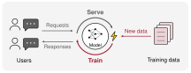

#  CTI

**Continuous Training and Inference** — a single-GPU engine that serves and fine-tunes the same model instance.

<p align="center">
  
</p>

[**Features**](https://github.com/mit-han-lab/cti-engine/blob/main/docs/features.md) | [**Configuration**](https://github.com/mit-han-lab/cti-engine/blob/main/docs/configuration.md) | [**Architecture**](https://github.com/mit-han-lab/cti-engine/blob/main/docs/structures.md) | [**Cookbook**](https://github.com/mit-han-lab/cti-engine/tree/main/cookbook) | [**Benchmarks**](https://github.com/mit-han-lab/cti-engine/tree/main/benchmark)

---

## About

CTI serves OpenAI-compatible inference and runs LoRA fine-tuning against one model
instance on one GPU. Serving and training take turns rather than running side by side, so
there is no second copy of the model and no weight transfer between the two. This is an
early release: the surface below is what we have tested, not what we plan.

- **One owner**: one model, one KV pool, and one revision counter. Inference CUDA graph
  objects survive residency switches; V0 training remains eager. There is no second
  model owner or cross-engine weight transfer.
- **Yields mid-step**: training pauses at a microbatch boundary, serves the waiting
  request, and resumes — it does not wait for the accumulation group to finish.
- **Two APIs**: OpenAI-compatible serving on `/v1/completions` and `/v1/chat/completions`,
  and typed Python control through `LLM.sample` and `TrainingSession` operations such as
  `forward_backward`, `optim_step`, `publish` (the trained adapter to inference), and
  `save_checkpoint`.
- **Inference features**: radix prefix cache, chunked prefill, overlap scheduling, CUDA
  graphs for decode and breakable graphs for prompt and mixed batches, priority
  admission, and DFlash-family speculative decoding.

## Status

- **Models**: dense Qwen3 is the maintained profile, gated against Transformers.
  Qwen3-MoE, dense Qwen3.5 (with image input) and Qwen3.5-MoE are implemented but not yet
  qualified. Qwen3.8-27B NVFP4 (ModelOpt mixed precision) is supported on RTX PRO 6000;
  it is not verified on RTX 5090, where it fits without DFlash2. ModelOpt checkpoints
  serve, LoRA adapters included, but do not train. See
  [`docs/features.md`](docs/features.md#supported-models).
- **Precision**: execution is BF16 only. `model.dtype` is `auto` or `bfloat16`; FP16 and
  FP32 checkpoints load converted to BF16, and block-FP8 and ModelOpt FP8/NVFP4
  checkpoints load quantized.
- **LoRA**: rank 1 to 128; the per-expert (`experts`) target takes a multiple of 8.
- **Speculative decoding**: DFlash v1 for Qwen3 and Qwen3.5 targets (dense or MoE) and
  DFlash2 for Qwen3.8 ([`docs/dflash.md`](docs/dflash.md)).
- **Prefix snapshots** (Qwen3.5's recurrent state): one per prefill call, at its last
  whole 64-token boundary, as in SGLang; a prompt whose length is a multiple of 64
  exports its end. fla-core, the provider below compute capability 8.9, exports none,
  so `cache.prefix: auto` uses the naive cache there.
- **Parallelism**: one GPU, or tensor/expert parallelism across the GPUs of one node
  (implemented but unqualified; [`docs/tensor-parallel.md`](docs/tensor-parallel.md)).

## Getting Started

### Docker

On an RTX 5090, RTX PRO 6000 or DGX Spark with Linux, an NVIDIA driver 580 or newer and the
[NVIDIA Container Toolkit](https://docs.nvidia.com/datacenter/cloud-native/container-toolkit/latest/install-guide.html):

```bash
docker run --rm --gpus all ghcr.io/mit-han-lab/cti-engine:0.0.1
docker run --rm --gpus all --ipc=host -p 1919:1919 -v cti-cache:/root/.cache \
  ghcr.io/mit-han-lab/cti-engine:0.0.1 \
  python -m cti --model.path Qwen/Qwen3-0.6B --server.host 0.0.0.0
```

The first command prints the installed versions and the GPU; the second serves Qwen3-0.6B
on port 1919 and keeps downloaded models and compiled kernels in the `cti-cache`
volume. [`docker/README.md`](docker/README.md) covers verification, rootless Docker and
building the image. Other GPUs need the install script.

### Install script

On Linux with an NVIDIA driver 580 or newer and any conda installation: Miniforge (which also
ships mamba), Miniconda or Anaconda. From a clone of this repository:

```bash
git clone https://github.com/mit-han-lab/cti-engine.git cti && cd cti
bash scripts/install.sh
conda activate cti
```

`scripts/install.sh` checks the prerequisites, downloads the pinned cti-kernels wheel
and checks its SHA256, creates the `cti` Conda environment (CUDA, PyTorch,
FlashAttention, cti-kernels and an editable cti), verifies it, and imports both
packages. Rerunning it verifies the existing environment; `--recreate` rebuilds it.
`--model Qwen/Qwen3-0.6B` also generates a few tokens through the offline `LLM` API.
When every GPU is SM120 or SM121 (RTX 5090, RTX PRO 6000, DGX Spark), FlashAttention comes
from a prebuilt, SHA256-pinned wheel on the cti-kernel release that
`environments/flash-attention-prebuilt.toml` names. On other GPUs, when that download
fails, or with `--build-flash-attn`, it is built from the locked source: the slow step
(about 10-20 minutes), whose parallelism `MAX_JOBS` caps.
If a download fails, download the wheels from the kernel release page and pass them with
`--kernel-wheel PATH` and `--flash-attn-wheel PATH`. Run `bash scripts/install.sh --help`
for every option.

### Hardware

This release is qualified on RTX 5090 and RTX PRO 6000 (Server Edition). On DGX Spark
(GB10), Qwen3.5-35B-A3B-FP8 is validated; other models are expected to work there but
are not separately qualified. GB10 shares its memory with the host, so the engine
defaults to 0.6 of free memory for weights and KV cache (0.9 on a discrete GPU) and keeps
training state resident while serving. Other NVIDIA GPUs may work when every required
provider supports them, but this release does not claim them as qualified hardware.

### Manual install

`scripts/install.sh` wraps `scripts/setup_env.py`, which can also be run directly with
Python 3.11 or newer. Choose any unused Conda name:

```bash
python -m pip install packaging
python scripts/setup_env.py create --name cti \
  --kernel-wheel cti_kernels-0.0.1-py3-none-any.whl
conda activate cti
```

On SM120/SM121 GPUs, add `--flash-attn-wheel` with this machine's wheel from
[`environments/flash-attention-prebuilt.toml`](environments/flash-attention-prebuilt.toml)
(assets of the same kernel release) to skip the FlashAttention build; setup checks its SHA256.

Numerical sources, operation tests and JIT assets belong to the separate
[kernel repository](https://github.com/mit-han-lab/cti-kernel). The engine pins one
kernel package version, never the reverse; no kernel source is duplicated here.
The setup command installs `cti-kernels[cute,gdn,varlen]==0.0.1` and an
editable engine. The `gdn` extra supplies fla-core, the `cute` extra the CuTe DSL and the
`varlen` extra flash-attn (the vision tower and training RoPE), which setup installs first:
from its prebuilt wheel, or built from the locked source.

The kernel releases independently; the engine keeps its pinned version until an
explicit dependency upgrade. The pinned wheel is published as the
[`v0.0.1` release](https://github.com/mit-han-lab/cti-kernel/releases/tag/v0.0.1)
of the kernel repository, not on a package index. Download
`cti_kernels-0.0.1-py3-none-any.whl` from it, check its SHA256
(`6df0cc5b13bcef44a5672c215eb19ac4b23f010ccb7da53fdcba1e99e4317f9c`), and pass its path
with `--kernel-wheel` as above. See [`docs/package-release.md`](docs/package-release.md)
for independent builds, paired validation and the engine/kernel package boundary.

### Run

Serve a model:

```bash
python -m cti --model.path "Qwen/Qwen3-0.6B"
```

Run online serving and local training against the same instance:

```bash
python cookbook/online_training.py --model "Qwen/Qwen3-0.6B"
```

`OnlineServer` owns the HTTP frontend and, on the same engine, `training_session()`,
`model_revision` and `sample()`, which returns `LLM.sample`'s exact samples for GRPO
alongside HTTP traffic; the command does not connect a second Python runtime to the CLI
server above. More runnable examples live in
[`cookbook/`](https://github.com/mit-han-lab/cti-engine/tree/main/cookbook): `sft.py`,
`grpo.py`, `online_training.py`, and `chat.py`.

## TODO

Completed items remain visible as `- [x] ~~completed item~~`.

- [x] ~~Add strict YAML configuration for Python and serving entrypoints.~~
- [x] ~~Support fixed-block DFlash-family speculative decoding (DFlash v1 and DFlash2).~~
- [x] ~~Add single-node multi-GPU execution with TP and EP.~~
- [x] ~~Support Qwen3-MoE, Qwen3.5 and Qwen3.5-MoE, including image input.~~
- [ ] Add sequence parallelism (SP).

## Acknowledgments

CTI began from [Mini-SGLang](https://github.com/sgl-project/mini-sglang) and
was substantially restructured for continuous inference and training. We also learned
from the architecture and engineering of [SGLang](https://github.com/sgl-project/sglang),
[vLLM](https://github.com/vllm-project/vllm),
[Unsloth](https://github.com/unslothai/unsloth), and
[TorchTitan](https://github.com/pytorch/torchtitan).

Adapted or retained source is limited to the portions identified in file headers and
[`THIRD_PARTY_NOTICES`](https://github.com/mit-han-lab/cti-engine/blob/main/THIRD_PARTY_NOTICES):
Mini-SGLang-derived engine code (MIT), Qwen3.5-family model, vision and RoPE code
adapted from
[Transformers](https://github.com/huggingface/transformers) (Apache-2.0), and the
DFlash draft model adapted from [z-lab/dflash](https://github.com/z-lab/dflash) (MIT).
Adapted numerical code belongs to `cti-kernels`, whose repository preserves its own
source credits and notices. Packages such as `sglang-kernel` are external dependencies,
not vendored source.

## License

CTI is released under the MIT License — see
[`LICENSE`](https://github.com/mit-han-lab/cti-engine/blob/main/LICENSE).
Original cti code and modifications are copyright 2026 cti contributors.
Files adapted from third-party projects keep their upstream licenses and notices, as
recorded in their headers and in
[`THIRD_PARTY_NOTICES`](https://github.com/mit-han-lab/cti-engine/blob/main/THIRD_PARTY_NOTICES).
